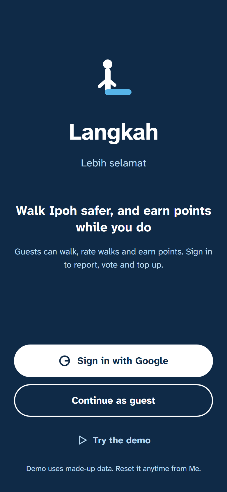
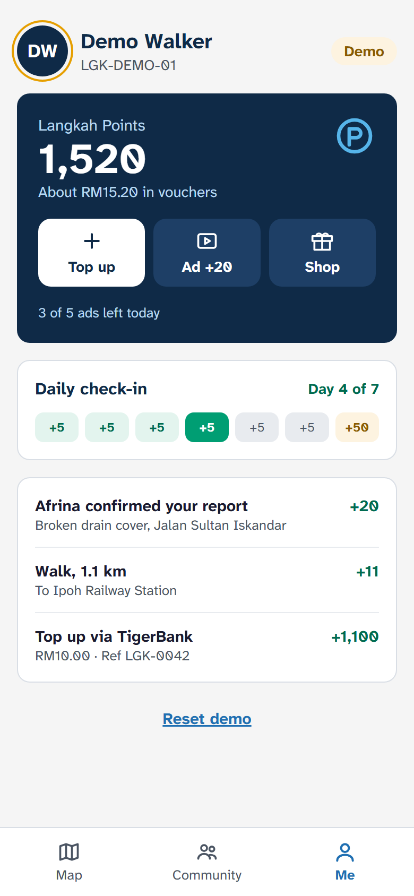
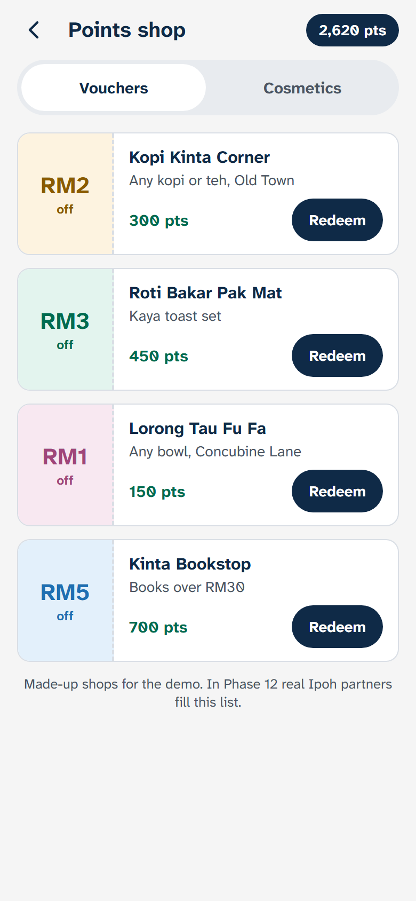
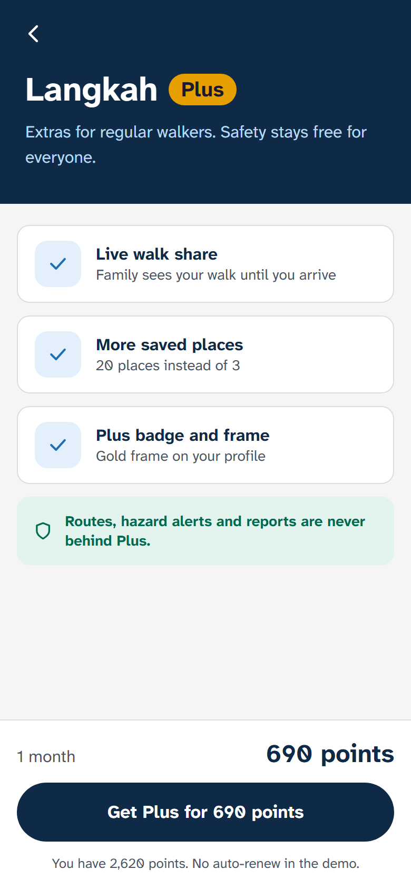
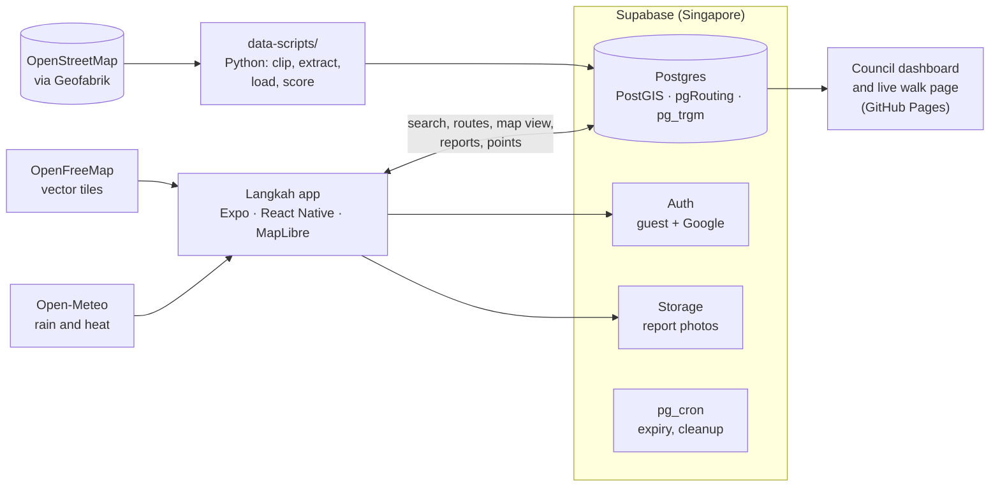

<p align="center">
  
</p>

<p align="center">
  <b>Safer walks, street by street.</b><br>
  A pedestrian safety and navigation app for Ipoh, Malaysia. Langkah treats the walker the way Waze treats the car.
</p>

<p align="center">
  
  
  
  
  
  
</p>

<p align="center">
  <a href="#features">Features</a> ·
  <a href="#how-it-works">How it works</a> ·
  <a href="#try-it">Try it</a> ·
  <a href="docs/DEVELOPMENT.md">Developer guide</a> ·
  <a href="https://affannajiy.github.io/langkah/">Council dashboard</a>
</p>

---

## Why Langkah

Walking in Ipoh means broken five-foot ways, faded zebra crossings, dark streets and floods after rain. Map apps are built for cars: they find the fastest walk, not the safest one, and they know nothing about the pothole that appeared last week.

Langkah scores every street in the pilot area for the walker, on sidewalks, lighting, crossings and reported hazards, by day and by night. It then compares the **safest** and the **fastest** walk, guides you turn by turn with hazard alerts worded by landmark, and lets walkers report and confirm problems so the map stays current. The improvements people want most are ranked for the local council.

Built by Group 4 of UTP's Technopreneurship Team Project (Universiti Teknologi PETRONAS), October 2026. Android only for the prototype.

## Screens

<p align="center">
  
</p>

<p align="center"><sub>Map home · Search · Safest vs fastest · Hazard ahead · Quick report · Report flow · Community · Arrival</sub></p>

<table>
  <tr>
    <td align="center"><br><sub>Welcome</sub></td>
    <td align="center"><br><sub>Points wallet</sub></td>
    <td align="center"><br><sub>Shop</sub></td>
    <td align="center"><br><sub>Langkah Plus</sub></td>
  </tr>
</table>

## Features

**Plan the walk**
- Search places in the pilot area, nearest first, with Home, UTP and Work shortcuts.
- Two routes side by side: **Safest** (solid teal) and **Fastest** (dashed grey), each with a 0 to 100 safety score and the reasons behind it: sidewalk cover, lighting, marked crossings, hazards and streets nobody has checked yet (dotted).
- Night scoring weighs lighting more. Prefer cover leans onto five-foot ways and covered paths when it rains. Step-free mode avoids stairs.

**Walk it**
- Turn-by-turn guidance with a 3D view behind the walker, plus 2D and north-up views.
- Haptics first: one pulse for a turn, two for a hazard ahead, one long pulse on arrival. Optional voice guidance.
- Alerts name a landmark ("before the zebra crossing"), never a side of the road, because phone GPS is only accurate to 5 to 10 m.
- Off-route rerouting, and live walk share: a friend follows a link until you arrive, then the position is deleted.

**Report and confirm**
- Quick report in two taps during a walk, or the full four-step flow with a photo.
- A hazard changes routes only after two other walkers confirm it (one if it has a photo). It expires after 7 days unless someone says it is still there.
- Improvement requests (a crossing, a street light) collect upvotes in the Community tab.
- Reports made offline wait on the phone and send when the signal is back.

**Close the loop with the council**
- The [council dashboard](https://affannajiy.github.io/langkah/) ranks requests by upvotes, maps hazards and exports CSV or GeoJSON.
- Council staff mark a request Planned or Fixed; the reporter hears about it in the app.
- Street checks on the Arrival screen fill gaps in OpenStreetMap: two walkers who agree rescore the street at once.

**Points, badges and the business side** (mock, for the demo)
- Langkah Points for walks, ratings and confirmed reports, a daily check-in, badges and a weekly walk streak.
- A shop with partner vouchers and map cosmetics, Langkah Plus, mock top-ups and mock 30 s ads. No real money moves. The ad brands are parodies.

**Built for everyone**
- Atkinson Hyperlegible Next, 48 dp touch targets, 4.5:1 contrast, and no meaning carried by colour alone.
- English and Bahasa Melayu. The prototype ships in English, with Malay kept behind a switch.
- Nothing blocks the screen during a walk: banners, bottom sheets and snackbars, with dialogs only for things that can't be undone.

## How it works



- **The phone never downloads the dataset.** Routes come back as encoded polylines, pins only for the visible map area, coordinates rounded to 5 decimals.
- **Routing runs in the database.** `route_safe` uses pgRouting over a walk network built from OpenStreetMap, with a day and a night cost per street segment. The penalties live in a table, so they can be tuned from walk ratings without a rebuild.
- **Rules live in SQL.** Every table has Row Level Security from the migration that creates it, and trust rules (who can confirm what, report limits, expiry) run as triggers and functions, not in the app.
- **RM0 to run.** Every service is on a free tier with no card on file.

The original MVP design is in [docs/Langkah Architecture.png](docs/Langkah%20Architecture.png), and the full design, every decision and the reasons are in the guide, [docs/Langkah Tech Stack.md](docs/Langkah%20Tech%20Stack.md).

### Pilot areas

| Area | Covers |
|---|---|
| Central Ipoh | Old Town, New Town, the railway station, Concubine Lane to Ipoh Parade |
| Seri Iskandar and UTP | Seri Iskandar town, Iskandar Bestari, UiTM, Hospital Seri Iskandar, the UTP campus |

Outside these the app says so and points to the nearest one. A walk can be up to 10 km.

## Stack

| Part | What we use |
|---|---|
| App | Expo SDK 57, React Native 0.86, TypeScript (strict), Expo Router |
| Map | `@maplibre/maplibre-react-native` with the OpenFreeMap Positron style, restyled in Langkah colours |
| Backend | Supabase: Postgres with PostGIS, pgRouting and pg_trgm, Auth (guest and Google), Storage, pg_cron |
| Data | OpenStreetMap, processed by Python scripts (pyosmium, shapely, pyproj) |
| Council dashboard | Plain HTML and JS with MapLibre GL JS, on GitHub Pages |
| Text | i18next with expo-localization (English and Bahasa Melayu) |
| Voice and weather | `expo-speech` on the phone; Open-Meteo (free, no key) |
| Builds | EAS, free tier |

## Try it

**On a phone:** install the latest preview APK from the **[Expo project page](https://expo.dev/accounts/affannajiy/projects/langkah)** (Builds, newest preview), then pick **Try the demo** on the welcome screen. You're signed in as Afrina, with points, reports and a demo crew who confirm what you post. **Reset demo** on the Me tab puts it all back.

**From source:** you need Node.js LTS, Android Studio with an emulator, and a free Expo account. Expo Go can't run MapLibre, so the app runs as a development build.

```bash
cd app
npm install
eas build -p android --profile development
npx expo start
```

Copy `app/.env.example` to `app/.env` first and fill in the Supabase URL and anon key. The full setup, the backend, the map data scripts and the demo script are in the **[developer guide](docs/DEVELOPMENT.md)**.

## Project status

The MVP in the guide is complete, along with the demo upgrade (live share, voice, weather, the council's Fixed loop, badges, street checks) and the feel upgrade (instant routes, the 3D walk view). Phase 20 fixed everything found in the full test of the preview APK; the next step is the third test run on phones.

<details>
<summary>All phases</summary>

| Phase | What |
|---|---|
| 0 | Expo app, theme, fonts, tab bar, map with OpenFreeMap, location permission, EN and BM |
| 1 | Supabase schema with RLS, OSM data loaded, routing network and safety scores |
| 2 | `search_places` and `route_safe` (safest and fastest walk, day and night scoring) |
| 3 | Map home, search sheet and route compare screens |
| 4 | Walking navigation, hazard banner, quick report, haptics |
| 5 | Sign-in, report flow, Community tab, trust rules and report expiry |
| 6 | Arrival, Me tab, Settings, onboarding, night map, demo mode, empty and error states |
| 7 | Demo readiness: demo photos, payload and accessibility checks, demo script, preview APK |
| 8 | Test and tune: scoring weights in a table, walk rating report, user test plan |
| 9 | Final test fixes, orphaned photo cleanup, revenue plan |
| 10 | Langkah Points, wallet, daily check-in, Try the demo, welcome screen |
| 11 | Shop, Langkah Plus, mock top-up, mock 30 s ads |
| 12 | Council dashboard on GitHub Pages, partner shops and sponsored pins |
| 13 | English only for the prototype (Malay kept behind a switch) |
| 14 | Final build fixes from the test notes |
| 15 | Pre-build audit, smaller APK, ESLint |
| 16 | More map detail: POI names, house numbers, covered walkways, kerb ramps, rest stops |
| 17 | Smaller EAS upload (539 MB to 6 MB) |
| 18 | Demo upgrade: live walk share, voice guidance, rain and heat, the council Fixed loop, badges and streaks, street checks, step-free mode |
| 19 | Feel upgrade: instant search and routes, nearby-first search, route sheet motion, 3D walk view |
| 20 | Full test and fix batch: demo crew, demo data kept in the demo, route rate limit, walks saved once, offline walk queue, Langkah dialogs, map and copy fixes |

What changed in each phase is in [CHANGELOG.md](CHANGELOG.md).

</details>

**Next** (guide Section 14): SOS to trusted contacts, wheelchair routing once kerb ramps are mapped, AI checks on report photos, more cities (a Penang pilot), iOS, and Play Store prep.

## Documentation

| Document | What's in it |
|---|---|
| [Developer guide](docs/DEVELOPMENT.md) | Setup, running, builds, backend, map data, checks, demo script, troubleshooting |
| [The guide](docs/Langkah%20Tech%20Stack.md) | The source of truth: product, design, data, scoring, every phase's plan |
| [Colour scheme](docs/langkah-colour-scheme.md) | The palette and how each colour is used |
| [Final test](docs/final-test.md) | The full test of the whole app, run by run |
| [Revenue plan](docs/revenue-plan.md) | Points, Plus, partners and the council offer |
| [Rulebooks](rulebooks/) | Engineering, security and UI/UX rules |

## Contributing

Issues and pull requests are welcome. Read [CONTRIBUTING.md](CONTRIBUTING.md) first, and follow the [code of conduct](CODE_OF_CONDUCT.md). To report a security problem privately, see [SECURITY.md](SECURITY.md).

## License and credits

The code is under the [MIT License](LICENSE). Some things in this repo are not covered by it:

- **Map data** © OpenStreetMap contributors, under the [ODbL 1.0](https://opendatacommons.org/licenses/odbl/). The credit stays visible on the map and in every export.
- **Demo report photos** are from Wikimedia Commons by Encik Tekateki, Wiki Asmah, Two hundred percent and Taufik, under CC BY-SA and CC BY. See [CREDITS.md](data-scripts/demo-photos/CREDITS.md).
- **The ad and voucher brands** in the shop and the mock ads are parodies made for an internal class demo. They are not real partners, and the MIT License grants no rights to any real brand they resemble.
- **Langkah's name and logo** identify this project; please don't use them for a different app.

Tiles by OpenFreeMap / OpenMapTiles. Weather by Open-Meteo.com (CC BY 4.0). Font: Atkinson Hyperlegible Next by the Braille Institute (SIL OFL). Icons: Lucide (ISC).
