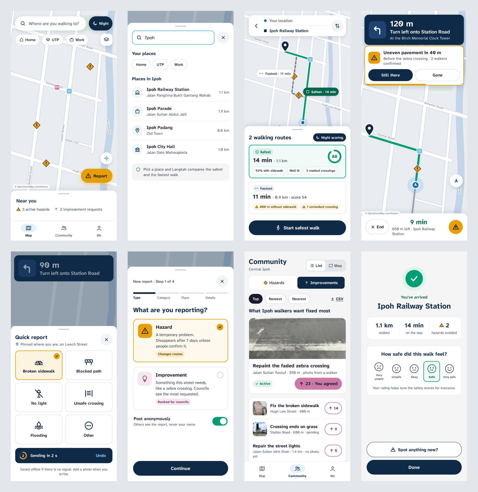

# Langkah Tech Stack and System Architecture Guide

Technopreneurship Team Project, Group 4

Version 1.5 \| 10 October 2026 \| Prepared by 'Affan Najiy Bin Rusdi

## 1. Purpose

This guide records the technology we chose for the Langkah MVP and the reason behind each choice. Langkah looks at the city from the walker's point of view, whereby the pedestrian is treated the way Waze treats the car. It is the single reference for all four developers, so whenever a question comes up on which service, library or tool to use, the answer should be here. Section 5 records the agreed screen plan after the review of the first Figma draft, and Section 6 describes the visual design we will build, based on the research listed in the References. Anything not covered here should be discussed with the team first and then added to this guide.

## 2. MVP Scope

The scope follows the proposal approved by Dr. Vijay Lahri. The MVP is a working Android app piloted on 1 to 2 walking corridors in Ipoh, in English and Bahasa Melayu, with a running cost of RM0.

| **Feature**                        | **What the MVP does**                                                                                                                                                | **Proposal link**  |
|------------------------------------|----------------------------------------------------------------------------------------------------------------------------------------------------------------------|--------------------|
| **Safe-route navigation**          | Generates a walking route scored on sidewalk continuity, crossings and lighting, with separate day and night scores. Shows the safest route next to the fastest one. | Objective 1        |
| **Live hazard alerts**             | While navigating, the app warns the user of upcoming turns and reported hazards within about 50 m, using vibration and an in-app banner.                             | Objective 2        |
| **Hazard and improvement reports** | Users pin a hazard (temporary) or an improvement request (permanent) with an optional photo. Other users confirm hazards and upvote improvements.                    | Objectives 2 and 3 |
| **Amenity layer**                  | Shows zebra crossings, shelters and bus stops on the map.                                                                                                            | Solution section   |
| **Council dataset**                | An in-app ranking of the most upvoted improvements, exportable as CSV or GeoJSON for local councils.                                                                 | Objective 3        |

*Table 1 shows the MVP features and the proposal item each one answers.*

**Out of scope for the MVP:** SOS and live location sharing, an iOS release, the OKU accessibility layer and AI classification of report photos. These are listed under future work in Section 14.

## 3. Tech Stack

| **Layer**       | **Choice**                                       | **Why we chose it**                                                                                                                                                                                      |
|-----------------|--------------------------------------------------|----------------------------------------------------------------------------------------------------------------------------------------------------------------------------------------------------------|
| Mobile app      | **React Native + Expo** (TypeScript)             | One codebase in TypeScript, works well in VS Code, and runs on our phones through a development build: a custom Langkah test app installed once, which then reloads code changes live just like Expo Go. |
| Base map        | **MapLibre** (@maplibre/maplibre-react-native)   | Open-source map library with full style control, so the calm civic look is ours. Needs a development build, which every map library now does, since Google Maps was removed from Expo Go from SDK 52.    |
| Map tiles       | **OpenFreeMap** (Positron style)                 | Free hosted OpenStreetMap tiles with no API key, no card and no usage limit. Shows the same OSM streets our routing uses.                                                                                |
| Place search    | **Our own \`places\` table** (Supabase, pg_trgm) | Ipoh place names imported from OSM, searched with fuzzy matching. Enough for a city pilot, free, and needs no outside service.                                                                           |
| Backend         | **Supabase**                                     | Database, login, file storage and server functions in one free project, so there is no server for us to maintain.                                                                                        |
| Geo database    | **PostGIS** (inside Supabase)                    | A Postgres extension that stores and queries map shapes such as points, lines and distances.                                                                                                             |
| Routing engine  | **pgRouting** (inside Supabase)                  | A Postgres extension that finds the lowest-cost path through a road network. We define cost as unsafety, so the lowest-cost path is the safest one.                                                      |
| Server logic    | **SQL functions + Supabase Edge Functions**      | Small pieces of backend code (SQL or TypeScript) that run on demand, for example routing, report expiry and data export.                                                                                 |
| Data processing | **Python + Jupyter** (pyosmium, geopandas)       | Offline scripts that clip the Ipoh road network, extract amenities and compute safety scores.                                                                                                            |
| Login           | **Guest mode + Google sign-in** (Supabase Auth)  | Anyone can navigate without an account. Signing in is only needed to report or upvote.                                                                                                                   |
| Translations    | **i18next + expo-localization**                  | Keeps all UI text in English and BM files instead of hard-coding it.                                                                                                                                     |
| Builds          | **Expo EAS**                                     | Expo's cloud build service, which produces the Android APK we install on test phones.                                                                                                                    |
| Code            | **GitHub monorepo**                              | One repository for all four of us, reviewed through pull requests.                                                                                                                                       |

*Table 2 lists every layer of the stack and the reason for the choice.*

## 4. System Architecture

*Figure 1 shows the Langkah MVP architecture. The editable source is the Architecture page in TTP Diagrams.drawio.*

The app talks to only two services. OpenFreeMap supplies the base map tiles, whereas Supabase holds everything that is ours: the scored road network, the reports, the amenities, the place search and the routing logic. The Python pipeline runs on a laptop and only when we refresh the data, so it is not part of the live system.

### 4.1 How a safe route is produced

1.  The user searches for a destination, and search_places() in Supabase returns matching Ipoh places with their coordinates.

2.  The app calls route_safe(start, end, mode) in Supabase, whereby mode is day or night depending on the current time.

3.  The function snaps both points to the nearest road and runs the pgRouting shortest-path search using the cost length x (1 + safety penalty + active hazard penalty).

4.  It also computes the plain shortest route, so the app can show a comparison such as "Safest: 14 min, Fastest: 11 min with 400 m of no sidewalk".

5.  The route comes back as an encoded polyline (a compact text format for a line, see Section 7.4), and the app draws it on the map together with the hazards and amenities along it.

6.  During the walk, the app compares the phone's GPS position with the upcoming turns and hazards and alerts the user when one is within about 50 m.

Since the hazards live in the same database as the road network, a newly confirmed hazard changes the very next route that is requested, without any separate routing server.

## 5. Screen and Interaction Plan

On 8 October 2026 I reviewed the first Figma draft (9 frames) against how current navigation apps handle the same moments. The draft already has the right core flow, which is search, safe route, navigate, hazard alert, report, community and journey complete. The changes below keep that flow and fix the gaps, following Google Maps' move to bottom sheets, Waze's "still there" confirmations and Android's navigation guidelines. The revised Figma file should follow this section.

### 5.1 App structure

The app uses a **bottom tab bar** with three tabs, **Map**, **Community** and **Me**, instead of the hamburger menu in the draft. A bottom tab bar keeps every main area one tap away, and Android's guidelines recommend it for three to five top-level destinations. It is also built into Expo Router, so it is the easiest option to build and to extend later. **Report** is a floating button on the Map tab, since a report always starts from a place on the map.

### 5.2 Screen list

| **\#** | **Screen**                    | **What it shows**                                                                                                                                                                                   | **vs draft** | **Priority**             |
|--------|-------------------------------|-----------------------------------------------------------------------------------------------------------------------------------------------------------------------------------------------------|--------------|--------------------------|
| 1      | Splash                        | Logo, then auto-advances after about 1.5 s. The Enter button is removed.                                                                                                                            | Revise       | P1                       |
| 2      | Onboarding: language          | English or Bahasa Melayu. Shown on first launch only.                                                                                                                                               | New          | P1                       |
| 3      | Onboarding: why location      | One-line value pitch and why Langkah needs location, then the Android permission prompt.                                                                                                            | New          | P1                       |
| 4      | Map (home)                    | Light muted map, search bar, Layers button, Report button, recentre button.                                                                                                                         | Revise       | P1                       |
| 5      | Search                        | Places with distance and area, recent searches and saved places. No safety score here, since no route exists yet.                                                                                   | Revise       | P1                       |
| 6      | Route compare (sheet)         | Both routes on the map with two cards: **Safest** (time, distance, score) and **Fastest** (time, distance, what it lacks, e.g. 400 m without sidewalk). Tap a card or a line to choose, then Start. | Revise       | P1                       |
| 7      | Route detail (sheet expanded) | Score breakdown: % with sidewalk, % lit, marked crossings, hazards on route, amenities on route.                                                                                                    | New          | P2                       |
| 8      | Navigation                    | Turn banner, route line, small hazard and amenity icons on the route only, bottom bar with time and distance left, **End** button and **Quick report** button.                                      | Revise       | P1                       |
| 9      | Hazard alert (banner)         | Non-blocking banner under the turn banner with vibration, auto-hides after about 6 s, with **Still there** and **Gone** buttons. Replaces the centred modal.                                        | Revise       | P1                       |
| 10     | Quick report (sheet)          | Six large hazard icons. One tap pins the hazard at the current GPS spot. Photo and note can be added after arrival.                                                                                 | New          | P1                       |
| 11     | Report flow (sheet)           | Four short steps: Hazard or Improvement, category, confirm the pin on the map, optional photo and note. Then submit.                                                                                | Revise       | P1                       |
| 12     | Sign-in prompt (sheet)        | "Sign in so others can trust your report" with Google sign-in. Appears only at the first report or vote.                                                                                            | New          | P1                       |
| 13     | Community: Hazards            | Nearby hazards with list or map view, status (pending or active) and Still there / Gone buttons.                                                                                                    | Revise       | P1                       |
| 14     | Community: Improvements       | Improvement requests with upvote count, sorted by Top, Newest or Nearest. Top requested is the council ranking, with an Export CSV button.                                                          | New          | P1                       |
| 15     | Report detail                 | Photo, category, mini map, status, votes, time reported and expiry date.                                                                                                                            | New          | P1                       |
| 16     | Arrival                       | Journey complete with distance, hazards avoided, star rating and "Spot anything new?" that opens the report flow.                                                                                   | Revise       | P1                       |
| 17     | Me                            | My reports with status, saved places (home, campus, work) and contribution stats.                                                                                                                   | New          | P1 (stats and badges P2) |
| 18     | Settings                      | Language, automatic day and night scoring, alert vibration, privacy notice.                                                                                                                         | New          | P2                       |
| 19     | Layers (sheet)                | Toggles for zebra crossings, shelters and bus stops.                                                                                                                                                | New          | P1                       |
| 20     | Empty and error states        | No GPS, no internet, no route found, no reports nearby.                                                                                                                                             | New          | P1                       |

*Table 3 lists every screen. P1 is needed for the Week 9 prototype, and P2 is built if time allows.*

### 5.3 Pop-ups and overlays

Each type of pop-up has one job, so the app behaves the same way everywhere. The main rule is that **nothing may block the screen while the user is walking**, because a pop-up that needs a tap pulls the user's eyes and hands away from the road.

| **Type**         | **Use it for**                                                      | **Examples**                                                     |
|------------------|---------------------------------------------------------------------|------------------------------------------------------------------|
| Bottom sheet     | Choices and forms, while the map stays visible behind               | Route compare, report flow, quick report, layers, sign-in prompt |
| Banner           | Time-sensitive information during navigation, never blocking        | Turn instruction, hazard alert, "Back on route"                  |
| Toast (snackbar) | Confirming an action, auto-hides after about 3 s                    | "Report sent, needs 2 confirmations", "Vote counted"             |
| Dialog (modal)   | Only for actions that cannot be undone, and never during navigation | "Delete this report?", location permission denied                |

*Table 4 shows when to use each kind of pop-up.*

### 5.4 Visual rules

- **One light, muted map style** on every screen, as set in the colour scheme document, so the route, hazards and amenities stand out. Navy (#0F2A47) is for the app bars and sheets.

- **One font, Atkinson Hyperlegible Next,** across all screens (Section 6.2). The draft mixes a serif font on the Community and Journey screens.

- **Never colour alone.** Safest uses teal with a shield icon and the word "SAFEST", and caution uses orange with a triangle icon and the word "CAUTION".

- **Touch targets of at least 48 dp** and text of at least 14 sp, with a contrast ratio of 4.5:1 or higher, since the app is used while walking and often in bright sunlight.

- **Hazards appear as small icons on the map**, not text boxes. Details go in the banner or the report detail sheet.

### 5.5 Main user flow

1.  First launch only: Splash, language, why location, then the location permission.

2.  Map: the user taps the search bar and picks a destination.

3.  Route compare: the user sees Safest and Fastest side by side and starts the one they choose.

4.  Navigation: turn and hazard banners appear as the user walks, and Quick report is one tap away.

5.  Arrival: the user rates the walk and can report anything new, signing in at that point if needed.

6.  Community and Me: the user confirms nearby hazards, upvotes improvements and tracks their own reports.

## 6. Design Direction

The first Figma draft is a good wireframe, but it looks basic. This section describes the look and feel we will build in code. It is written as a description first, so the team can agree on it before anyone redraws the screens. The direction is **calm civic**, whereby Langkah should feel like a trustworthy public-good app that a city council would happily stand behind, not a flashy consumer app. Every choice below is tied to a source in the References.

### 6.1 Design principles

| **Principle**             | **What it means on screen**                                                                                                                      | **Evidence**                                                                                                                                                                                                                                                                           |
|---------------------------|--------------------------------------------------------------------------------------------------------------------------------------------------|----------------------------------------------------------------------------------------------------------------------------------------------------------------------------------------------------------------------------------------------------------------------------------------|
| **Glance, don't stare**   | During a walk the user should only need a glance. Turns and hazards arrive as vibration first and big, short text second. No reading, no typing. | Phone users miss obvious events around them (Hyman et al., 2010), and phone-related pedestrian injuries are rising (Nasar & Troyer, 2013). Vibration cues cut screen time without hurting navigation (Pielot et al., 2012). Google Live View also tells walkers to look only at turns. |
| **Show the trade-off**    | Always show the safest and fastest route side by side, with the reason for the difference in plain words.                                        | Pleasant or safer routes are usually only slightly longer than the shortest one (Quercia et al., 2014). Multi-factor walking routes can be built from OSM data (Novack et al., 2018).                                                                                                  |
| **Trust is visible**      | Every report shows its status, how many people confirmed it and when it expires. Users can answer "Still there" or "Gone".                       | Volunteered data needs crowd, social and geographic checks (Goodchild & Li, 2012). Waze uses the same Still there / Not there prompt.                                                                                                                                                  |
| **Honest about data**     | Streets we have not audited are shown as "not yet checked", never as safe.                                                                       | OSM is accurate where it has data but uneven in coverage (Haklay, 2010), and sidewalks are often missing from it (Mobasheri et al., 2018).                                                                                                                                             |
| **Night is different**    | After dark the app switches to night scoring, a darker map and gives lighting more weight.                                                       | Lighting raises reassurance after dark (Fotios et al., 2015). Malaysian pedestrian deaths peak at 8 to 9 PM (Solah et al., 2018), and many Ipoh street lights are still faulty (Ipoh Echo, 2026b).                                                                                     |
| **Accessible by default** | Meaning is never shown by colour alone, every button is at least 48 dp, and route lines differ by pattern as well as colour.                     | WCAG 2.2 (W3C, 2024) and Android accessibility guidance (Android Developers, 2026b). Wheelmap and Google's step-free routes pair colour with icons.                                                                                                                                    |

*Table 5 lists the design principles and the research behind each one.*

### 6.2 Visual language

| **Element**           | **Specification**                                                                                                                                                                                                                                                                                                                                                                                       |
|-----------------------|---------------------------------------------------------------------------------------------------------------------------------------------------------------------------------------------------------------------------------------------------------------------------------------------------------------------------------------------------------------------------------------------------------|
| **Colour roles**      | Navy \#0F2A47 for app bars, sheets in night mode and primary text on light surfaces. Off-white \#F5F5F5 for surfaces. Sky blue \#56B4E9 for buttons and links. Teal \#009E73 for safe and confirmed. Orange \#E69F00 for hazards and caution. Muted pink \#CC79A7 for community and upvotes. All from the Okabe-Ito based colour scheme.                                                                |
| **Route lines**       | Safest: solid teal line, 6 dp, with a white outline. Fastest: grey dashed line, 4 dp. Not yet checked segments: dotted. Each route carries a small label on the map, so the lines differ by pattern, colour and text.                                                                                                                                                                                   |
| **Map style**         | A MapLibre style based on OpenFreeMap Positron: light grey land, white roads, fewer shop and business icons, but bus stops and crossings kept. A separate dark navy night style switches on automatically after dark. The OpenStreetMap credit always stays visible above the sheets.                                                                                                                   |
| **Typography**        | One family, Atkinson Hyperlegible Next, made by the Braille Institute for maximum legibility, which suits glancing at a phone while walking. It replaces Inter, the default that most AI-generated designs use. Navigation instruction 30 sp bold, screen titles 20 to 26 sp, body 16 sp, labels at least 13 sp.                                                                                        |
| **Shape and spacing** | 8 dp spacing grid. Sheets have 16 dp top corners, cards 12 dp, chips are fully rounded. Soft shadows only on sheets and floating buttons.                                                                                                                                                                                                                                                               |
| **Icons**             | Simple rounded line icons in the app chrome. Hazard pins on the map are orange diamonds with a dark outline and an exclamation mark, the shape of Malaysian road warning signs. Six custom hazard icons (broken sidewalk, blocked path, no light, unsafe crossing, flooding, other) and three amenity icons (crossing, shelter, bus stop), each on a small white circle so they read on any map colour. |
| **Haptics**           | One short pulse for a turn, two pulses for a hazard ahead and one long pulse on arrival, so the user can tell them apart without looking.                                                                                                                                                                                                                                                               |
| **Motion**            | Sheets slide up with a gentle spring, banners slide down in about 200 ms. No decorative animation during navigation.                                                                                                                                                                                                                                                                                    |

*Table 6 sets out the visual language.*

### 6.3 Hero screens

These are the 8 screens to redesign first, since together they tell the whole Langkah story in the PR2 demo and the pitch. Each one lists its layout from top to bottom, the key interaction and what inspired it.

#### Screen 1. Map home

- **Layout:** A floating search pill at the top ("Where are you walking to?"), with a small moon or sun chip beside it showing whether day or night scoring is on. Under it, a row of saved-place chips (Home, UTP, Work) and a Layers button. The light map fills the screen with the user's blue dot and small hazard icons nearby. A collapsed sheet peeks above the tab bar with "3 active hazards and 2 improvement requests near you". An extended orange Report button sits bottom right, and the tab bar (Map, Community, Me) sits at the very bottom.

- **Interaction:** Tapping the peek sheet expands the nearby list. Tapping a hazard icon opens its report card in the sheet, never a full new page.

- **Inspired by:** Google Maps' 2024 sheet redesign, which keeps the map visible and puts controls within thumb reach (Li, 2024), and saved routes in Apple Maps (Apple, 2024).

#### Screen 2. Search

- **Layout:** A sheet slides up over the map with the search field focused and a clear "x" to close. Below it, recent searches, then saved places, then results showing the place name, area and walking distance ("Ipoh Railway Station, Jalan Panglima Bukit Gantang Wahab, 1.1 km"). No safety scores yet, because no route has been worked out.

- **Interaction:** Picking a result goes straight to route compare. Swiping the sheet down returns to the map.

- **Inspired by:** Google Maps' sheet-based search (Li, 2024).

#### Screen 3. Route compare

- **Layout:** The map zooms to fit both routes, with the safest line solid teal and the fastest line dashed grey. A compact From and To bar sits at the top. The half-height sheet holds two cards. The **Safest** card has a teal shield badge, "14 min, 1.1 km", a score ring showing 88 and three plain reason chips ("92% with sidewalk", "Well lit", "3 marked crossings"). The **Fastest** card shows "11 min, 0.9 km" with orange warning chips ("400 m without sidewalk", "1 unmarked crossing"). Below the cards is a full-width "Start safest walk" button.

- **Interaction:** Tapping a card or a line selects that route. Dragging the sheet up shows the full breakdown, the amenities along the way and a note if part of the route is not yet checked.

- **Inspired by:** Route cards with the key numbers on the first line (Apple, 2024), Citymapper's route comparison (Saindane, 2026), and research showing the safer route costs only a few minutes (Quercia et al., 2014).

#### Screen 4. Navigation with hazard banner

- **Layout:** A navy instruction card at the top with a large turn arrow, the distance ("120 m") and a landmark ("Turn left onto Station Road, at the Birch Memorial Clock Tower"). The map rotates with the user and shows only the active route, plus hazard and amenity icons on that route. A slim bar at the bottom shows "9 min, 650 m left", an End button and a Quick report button. When a hazard is close, an orange-edged banner slides down under the instruction card: "Uneven pavement in 40 m. Before the zebra crossing.", with Still there and Gone buttons and a thin countdown line. It vibrates twice and hides itself after about 6 seconds.

- **Interaction:** The banner never blocks the map and needs no tap. Answering Still there or Gone feeds the confirmation rule in Section 7.2.

- **Inspired by:** Waze's Still there prompt (Google, n.d.-a), Citymapper's well-timed, route-specific alerts (Saindane, 2026), and vibration guidance (Pielot et al., 2012).

#### Screen 5. Quick report

- **Layout:** A sheet rises from the bottom bar with six large tiles in a 2 by 3 grid, each with an icon and a short label (Broken sidewalk, Blocked path, No light, Unsafe crossing, Flooding, Other).

- **Interaction:** One tap pins the report at the user's current location and sends it after a 3 second countdown, with an Undo button. Offline reports wait in a queue. A snackbar confirms "Reported. Add a photo when you arrive.".

- **Inspired by:** Waze's two-tap report with auto-send and offline queue (Google, n.d.-b) and Material snackbars anchored above the bottom bar (Material Components for Android, n.d.-b).

#### Screen 6. Report flow

- **Layout:** A sheet with four short steps and a progress indicator. Step 1: two large choices, **Hazard** ("A temporary problem. Disappears after 7 days unless confirmed.") and **Improvement** ("Something this street needs. Councils see the most requested."). Step 2: category chips with icons. Step 3: a pin on the map that the user can drag, with the street name shown. Step 4: an optional photo and note, and a "Post anonymously" switch that is on by default.

- **Interaction:** If the user is a guest, a small sign-in sheet appears only at Submit. After posting, a snackbar shows the status: "Pending. Needs 2 confirmations.".

- **Inspired by:** WalkSafe's anonymous reporting (Wakefield Council, 2024), Project Sidewalk's simple labelling (Saha et al., 2019) and FixMyStreet as a channel to councils (King & Brown, 2007).

#### Screen 7. Community

- **Layout:** A switch at the top for **Hazards** and **Improvements**, plus a Map or List toggle. Each card has a photo thumbnail, the title, street and distance, a status chip (Pending, Active or Expired, each with an icon) and, for improvements, a pink upvote button with a count. Sort chips: Top, Newest, Nearest. The Top view is headed "Most requested in Ipoh" and has an Export CSV button for councils.

- **Interaction:** Hazard cards have Still there and Gone buttons. Improvement cards have one upvote per user. Tapping a card opens its detail sheet with a mini map.

- **Inspired by:** Wheelmap's icon-plus-status markers (International Telecommunication Union, 2024), Project Sidewalk's validation (Saha et al., 2019), and the risk that report counts follow neighbourhood wealth rather than need (Pak et al., 2017), which is why we also sort by Nearest.

#### Screen 8. Arrival

- **Layout:** A calm off-white screen with a teal check, "You've arrived at Ipoh Railway Station" and a row of three numbers: 1.1 km walked, 14 min, 2 hazards avoided. Below it, "How safe did this walk feel?" with a 5-point scale using faces and labels, then a "Spot anything new?" button and a Done button.

- **Interaction:** The rating is optional and one tap. Spot anything new opens the report flow, already pinned along the route just walked.

- **Inspired by:** The Malaysian finding that pedestrians rate safety lowest of all walkability factors (Arshad et al., 2016).

### 6.4 Final screens and logo

The 8 hero screens and the logo were finalised on 10 October 2026 in the Claude Design canvas "Langkah Hero Screens". Figure 2 shows the screens as they will be built. The screens were checked against current lists of AI-generated design tells (925 Studios, 2026; TeneX Studio, 2026), which is why they use the team's own evidence photos instead of placeholder squares, realistic pilot numbers, normal headings instead of uppercase labels, and hazard pins shaped like Malaysian road warning signs.

*Figure 2 shows the 8 final screens. Top row: map home, search, route compare, navigation. Bottom row: quick report, report flow, community, arrival.*

| **Element**        | **Final decision**                                                                                                                                                                                                                                              |
|--------------------|-----------------------------------------------------------------------------------------------------------------------------------------------------------------------------------------------------------------------------------------------------------------|
| **Logo**           | A person and their shadow forming the letter L: a white round head and straight body as the upright stroke, and a light blue shadow line as the base, on a navy rounded square. The light version uses a navy figure and a darker blue (#1F6FB2) base on white. |
| **Wordmark**       | The logo acts as the L of "Langkah", followed by "angkah" in Atkinson Hyperlegible Next bold.                                                                                                                                                                   |
| **Tagline**        | "Lebih selamat" (safer). The English version, if needed, is "Safer".                                                                                                                                                                                            |
| **Loading screen** | Navy background, the white mark, "Langkah" and "Lebih selamat", with a thin light blue progress bar.                                                                                                                                                            |
| **Logo files**     | Design Assets/Logo/: icon-1024.png (app icon), adaptive-icon-foreground-1024.png (Android adaptive icon, with \#0F2A47 as the background colour), splash-mark-white-512.png, dark and light icons in PNG and SVG, and the mark alone in white or navy SVG.      |
| **Screen images**  | Design Assets/Screens/: one PNG per screen at 2x, for the report, slides and the coding hand-off.                                                                                                                                                               |

*Table 7 records the final brand decisions and where the files are.*

### 6.5 Components to build once

To keep the Figma file and the code in step, the designer and the mobile developer should build these as reusable components with the same names in both: SearchPill, PlaceChip, RouteCard, ScoreRing, ReasonChip, InstructionCard, HazardBanner, BottomBar, ReportTile, StepSheet, ReportCard, StatusChip, VoteButton and Snackbar. Colours and sizes go into Figma variables that match the code theme file.

## 7. Data Strategy

The Week 3 progress report flagged our biggest risk: OpenStreetMap (OSM, the free community-built world map) may not have enough sidewalk data for Ipoh. We do not have time for a ground survey, so the data is built in three layers.

| **Layer**           | **Source**                                                                                                            | **Coverage**               | **Effort**                      |
|---------------------|-----------------------------------------------------------------------------------------------------------------------|----------------------------|---------------------------------|
| 1\. Baseline        | OSM road network: road type, lanes, speed limit, plus any existing sidewalk, lit, crossing, bus stop and shelter tags | All of Ipoh                | One Python script (Section 7.3) |
| 2\. Corridor detail | **Virtual street audit** on Mapillary street-level imagery, plus Mapillary's detected street lights and crosswalks    | The 1 to 2 pilot corridors | About one evening per person    |
| 3\. Live updates    | In-app hazard and improvement reports                                                                                 | Grows with usage           | Part of the app                 |

*Table 8 shows the three data layers.*

A virtual street audit is the inspection of streets through street-level photos on a laptop instead of walking them, which published walkability research has validated as a substitute for field surveys (Steinmetz-Wood et al., 2019).

**Licensing rule:** any data we store must come from OSM or Mapillary, since both are openly licensed. Google Street View may be used to look and double-check only, as Google's terms do not allow copying data out of it and OSM forbids mapping from Google sources.

### 7.1 Safety scoring, version 1

| **Condition on a road segment**                   | **Day penalty** | **Night penalty** |
|---------------------------------------------------|-----------------|-------------------|
| No sidewalk on a main road (primary or secondary) | +1.5            | +2.0              |
| No sidewalk on a residential road                 | +0.3            | +0.5              |
| Road not lit                                      | 0               | +1.0              |
| Crossing a main road without a marked crossing    | +1.0            | +1.5              |
| Traffic at 60 km/h or more next to the path       | +0.5            | +0.7              |
| Not yet audited (unknown)                         | +0.2            | +0.4              |
| Active confirmed hazard                           | +3.0            | +3.0              |

*Table 9 shows the starting penalties, which will be tuned after test walks with users.*

The penalties live in the `private.score_weights` table, so a tuning change is one SQL update and a rescore, with no new migration. `docs/user-test-plan.md` lists the steps.

### 7.2 Keeping reports trustworthy

This answers the moderation issue raised in the Week 3 progress report. Both kinds of report live in one reports table, with one map-pin screen and one voting flow.

- **Hazard:** starts as pending and only affects routing once it has 2 confirmations, or 1 confirmation with a photo. It expires after 7 days unless someone taps "still there".

- **Improvement:** never expires and is ranked by upvotes, with one vote per user. It feeds the council dataset, not the routing.

- A scheduled Edge Function handles expiry every night, so no admin is needed for the MVP.

### 7.3 How to get the real Ipoh data

The real pedestrian layout of Ipoh comes from OpenStreetMap, downloaded once from **Geofabrik**, the standard free mirror for OSM country extracts. The data is licensed under ODbL 1.0, so the app and any exported file must credit "(c) OpenStreetMap contributors". The script ipoh_extract.py in Tech Assets/data-scripts/ does the processing; it was tested on sample OSM data. The steps below run on a Windows laptop.

1.  **Download (about 240 MB, once).** Open download.geofabrik.de, go to Asia, then Malaysia, Singapore, and Brunei, and download malaysia-singapore-brunei-latest.osm.pbf. A .pbf file is OSM's compressed binary format. Save it into data-scripts/raw/, which is git-ignored so the big file never goes into the repository.

2.  **Set up Python (once).** Open Miniforge Prompt and run conda create -n langkah python=3.12 then conda activate langkah then pip install -r requirements.txt inside the data-scripts folder.

3.  **Run the extractor.** python ipoh_extract.py raw/malaysia-singapore-brunei-latest.osm.pbf out. It takes a few minutes. The default area is central Ipoh (longitude 101.068 to 101.100, latitude 4.583 to 4.612), and --bbox changes it.

4.  **Check the outputs** in out/: ipoh-central.osm.pbf (the clipped raw data), walk-network.geojson (walkable lines with sidewalk, lit and crossing tags), amenities.geojson (crossings, bus stops, shelters, street lamps, traffic signals), coverage-report.md and preview.png.

5.  **Read the coverage report.** It shows how many km of Ipoh streets have sidewalk and lighting information. The "unknown" streets on our pilot corridors become the to-do list for the Mapillary virtual audit.

6.  **Refresh monthly.** Geofabrik updates the file daily, so re-running the steps once a month picks up new OSM edits, including any we contribute ourselves.

### 7.4 From data to phone: keeping it small

Langkah is a mobile app used on mobile data, so the phone must never download the dataset itself. The full data lives on the server, and the phone only receives small, compressed pieces of what it needs at that moment.

| **What the phone needs** | **How it gets it**                                                                                                                                                       | **Typical size**           |
|--------------------------|--------------------------------------------------------------------------------------------------------------------------------------------------------------------------|----------------------------|
| Base map                 | Vector tiles from OpenFreeMap, loaded only for the area on screen and cached by MapLibre. Vector tiles are compressed map pieces, around ten times smaller than GeoJSON. | Tens of KB per screen      |
| A route                  | Worked out by route_safe() on Supabase and sent back as an encoded polyline, which is a compact text format for a line.                                                  | Under 1 KB for a 2 km walk |
| Hazards and amenities    | Only the points inside the visible map area, with coordinates rounded to 5 decimals (about 1 m), sent with gzip compression.                                             | A few KB                   |
| Place search             | Matches from our places table (Ipoh place names from OSM), at most 10 results per keystroke.                                                                             | Under 2 KB                 |
| Offline (later)          | A single PMTiles file of central Ipoh, built once and cached on the phone for walks with no signal.                                                                      | A few MB, once             |

*Table 10 shows how each kind of data reaches the phone.*

In addition, display lines are simplified so that points closer than about 1 m are dropped, which keeps the map smooth on older phones. React Native's networking on Android accepts gzip-compressed responses by default, so compression needs no extra code in the app.

### 7.5 Sidewalk-level network for the pilot corridors

Langkah looks at the city from the walker's point of view, whereby the pedestrian is treated the way Waze treats the car. Road-level data only knows that a road has a sidewalk. A **sidewalk-level network** draws every sidewalk, footpath and crossing as its own line, so a route can show which side of the road to walk on and exactly where to cross. pgRouting needs no change for this, since sidewalks and crossings are simply more lines in the same graph.

| **Option**                 | **What it is**                                                                                                                                                                                                               | **Decision**                                                                                                            |
|----------------------------|------------------------------------------------------------------------------------------------------------------------------------------------------------------------------------------------------------------------------|-------------------------------------------------------------------------------------------------------------------------|
| **OSM separate sidewalks** | OpenStreetMap's standard for drawing each sidewalk as its own path (footway=sidewalk) with crossings as short links (footway=crossing). The road is then tagged sidewalk:both=separate. ipoh_extract.py already reads these. | **Use.** We draw them for the pilot corridors in the free iD editor, tracing aerial imagery that OSM is allowed to use. |
| **OpenSidewalks**          | A sidewalk mapping standard from the University of Washington, compatible with OSM, covering width, surface, kerbs and slope. Their AccessMap app shows sidewalk routing in practice.                                        | **Use** as our mapping rulebook and design reference.                                                                   |
| **Tile2Net**               | Open-source AI from NYU and MIT that finds sidewalks and crosswalks in aerial photos.                                                                                                                                        | **Future work.** It needs very sharp aerial imagery (built-in sources are US cities) and an NVIDIA GPU.                 |
| **Moovit**                 | A public transit app. Its walking directions are road-level.                                                                                                                                                                 | Not a data source for us.                                                                                               |

*Table 11 compares the ways to get sidewalk-level data.*

**Our plan is a hybrid.** The whole city stays at road level with sidewalk tags, while the 1 to 2 pilot corridors (about 3 to 5 km of streets) are drawn at sidewalk level by the team, roughly two evenings shared across four people. At the demo, the route visibly runs along the correct side of the street and crosses at the real zebra crossing, and the team becomes a genuine contributor to Ipoh's OpenStreetMap data.

**One honest limit:** phone GPS in a city is only accurate to about 5 to 10 m, so during a walk the app cannot always tell which side of the road the user is on. Sidewalk-level data improves the route plan and what the map shows, while live tracking stays approximate. Alerts are therefore worded by landmark, such as "Cross at the zebra crossing ahead", never by assumed side.

## 8. Data Model

| **Table**     | **Main columns**                                                                                                         | **Notes**                                                                                        |
|---------------|--------------------------------------------------------------------------------------------------------------------------|--------------------------------------------------------------------------------------------------|
| road_segments | geometry, source and target node, length, road type, sidewalk, lit, crossing, speed, score_day, score_night, data_source | Built by the Python pipeline. Used by pgRouting.                                                 |
| reports       | kind (hazard or improvement), category, geometry, note, photo, status, created_at, expires_at, user                      | Status is pending, active or expired.                                                            |
| report_votes  | report, user, created_at                                                                                                 | One confirmation or upvote per user per report.                                                  |
| amenities     | type (crossing, shelter, bus stop), geometry, name, source                                                               | Imported from OSM and the corridor audit.                                                        |
| places        | name, alternative names, category, geometry                                                                              | Ipoh place names from OSM for search. Searched with the pg_trgm extension (fuzzy text matching). |

*Table 12 shows the five core tables.*

Row Level Security (RLS, Postgres rules that decide who may read or change each row) must be switched on for every table from day one. For instance, users may only edit their own reports, and guests may read but not write.

## 9. Software to Install

Everyone develops on Windows and tests on their own Android phone, so the list below is for Windows. Android Studio is only needed by anyone who wants to preview the app on a desktop (Section 9.3), and Docker Desktop is **not** needed, since we use the hosted Supabase project instead of a local copy.

| **Software**                                     | **Used for**                                                                                      | **Who needs it**               |
|--------------------------------------------------|---------------------------------------------------------------------------------------------------|--------------------------------|
| **Visual Studio Code**                           | Main code editor                                                                                  | Everyone                       |
| **Git for Windows**                              | Version control, with Git Bash as a terminal                                                      | Everyone                       |
| **Node.js (LTS version)**                        | Runs Expo, the EAS CLI and the Supabase CLI                                                       | Everyone                       |
| **Langkah development build** (APK on the phone) | Our custom test app from EAS, installed once. It reloads code changes live, like Expo Go.         | Everyone                       |
| **GitHub Desktop** (optional)                    | Point-and-click Git for anyone new to the command line                                            | Anyone                         |
| **EAS CLI** (npm install -g eas-cli)             | Builds the Android APK in Expo's cloud                                                            | Mobile UI, Maps and routing    |
| **Supabase CLI** (npx supabase)                  | Database migrations and Edge Functions                                                            | Backend, Maps and routing      |
| **Miniforge** (Python 3.12)                      | Python environment for the data scripts (pyosmium, shapely, pyproj, matplotlib). See Section 7.3. | Data                           |
| **QGIS** (LTR version)                           | Viewing the Ipoh road network and scores on a map to check the data                               | Data                           |
| **draw.io Desktop**                              | Editing the architecture and flow diagrams                                                        | Anyone                         |
| **Figma**                                        | Opening the UI designs and inspecting sizes and colours                                           | Mobile UI, everyone for review |
| **Android Studio** (optional)                    | Android Emulator for running the APK on a desktop, with a fake GPS walk (Section 9.3)             | Anyone previewing on a laptop  |
| **Android Platform Tools** (optional)            | adb for installing APKs and reading logs over USB                                                 | Mobile UI, Maps and routing    |

*Table 13 lists the software each role needs.*

### 9.1 VS Code extensions

| **Extension**          | **Used for**                                      |
|------------------------|---------------------------------------------------|
| ESLint and Prettier    | Consistent code style and catching mistakes early |
| Expo Tools             | Autocomplete for Expo config files and debugging  |
| Python and Jupyter     | Running the data notebooks inside VS Code         |
| PostgreSQL (Microsoft) | Running SQL against Supabase from the editor      |
| GitLens                | Seeing who changed what and when                  |
| i18n Ally              | Editing English and BM text side by side          |
| Draw.io Integration    | Opening .drawio files directly in VS Code         |

*Table 14 lists the recommended VS Code extensions.*

### 9.2 Accounts to create

| **Account**                          | **Used for**                                                                              | **Cost**                                |
|--------------------------------------|-------------------------------------------------------------------------------------------|-----------------------------------------|
| GitHub (with Student Developer Pack) | Code repository                                                                           | Free                                    |
| Expo                                 | EAS builds                                                                                | Free tier                               |
| Supabase                             | Backend project                                                                           | Free tier                               |
| Google Cloud (OAuth only)            | A Google sign-in client ID for Supabase Auth. No Maps APIs and no billing account needed. | Free                                    |
| Mapillary                            | Imagery and detection API token                                                           | Free                                    |
| Google Play Console                  | Publishing to the Play Store, only if we go beyond APK testing                            | USD 25 one-time, not needed for the MVP |

*Table 15 lists the accounts the team needs.*

### 9.3 Previewing the app on a desktop

Anyone can try Langkah on their own computer through the **Android Emulator**, a virtual Android phone that runs in a window. It is part of Android Studio, which is free. Note that installing our APK on a real Android phone needs no rooting or jailbreaking either: the phone only asks once to allow installs from that source. Windows' own Android support (Windows Subsystem for Android) was discontinued in March 2025, so the emulator is the way to go.

| **Step**                          | **What to do**                                                                                                                                                                                                                     |
|-----------------------------------|------------------------------------------------------------------------------------------------------------------------------------------------------------------------------------------------------------------------------------|
| 1\. Check the laptop              | Windows 10 or 11, 64-bit, 16 GB RAM recommended (8 GB works slowly), about 15 GB free disk, and virtualization switched on in the BIOS (Intel VT-x or AMD-V). Task Manager, Performance, CPU shows "Virtualization: Enabled".      |
| 2\. Install Android Studio        | Download from developer.android.com/studio and run the standard setup. It installs the Android SDK, the emulator and its own Java, so nothing else is needed.                                                                      |
| 3\. Create a virtual phone        | In Android Studio, open Device Manager, create a Pixel phone with a recent Android system image (x86_64, Google APIs), and start it.                                                                                               |
| 4\. Get the APK                   | From the EAS build page or eas build:run -p android --latest, which downloads and installs it into the running emulator. A downloaded APK can also be dragged onto the emulator window, or installed with adb install langkah.apk. |
| 5\. Fake a walk                   | In the emulator's Extended Controls, open Location, then Routes, and play a route through Ipoh Old Town. The app then believes the phone is walking, which is how we test turn and hazard alerts at a desk.                        |
| 6\. Optional: mirror a real phone | scrcpy is a free tool that shows a USB-connected Android phone on the desktop, handy for screen recordings in the pitch video.                                                                                                     |

*Table 16 shows how to run Langkah on a desktop.*

There are two kinds of APK. The **development build** connects to a teammate's laptop and reloads code changes live, so it is for developers. The **preview build** (eas build -p android --profile preview, with buildType: apk in eas.json) runs on its own with no laptop, so it is for testers, the supervisor and the demo.

## 10. Repository and Workflow

| **Folder**    | **Contents**                                                                                                                                 |
|---------------|----------------------------------------------------------------------------------------------------------------------------------------------|
| app/          | Expo app: screens, map, routing calls, alerts, EN and BM text files                                                                          |
| supabase/     | Migrations, route_safe() and other SQL functions, RLS policies, Edge Functions                                                               |
| data-scripts/ | ipoh_extract.py and notebooks for the OSM import, Mapillary pull, corridor audit and scoring. Raw downloads go in a git-ignored raw/ folder. |
| docs/         | This guide, the decision log and diagrams                                                                                                    |

*Table 17 shows the monorepo layout.*

- Work on a feature branch and merge into main only through a pull request reviewed by one teammate.

- Every database change is a migration file in supabase/. Nobody edits tables by hand in the dashboard.

- API keys go in a local .env file that is never committed. Share keys through a private chat, not the repository.

## 11. Team Roles

| **Role**         | **Owns**                                                                          | **Member**     |
|------------------|-----------------------------------------------------------------------------------|----------------|
| Mobile UI        | Screens from the Figma designs, navigation between screens, EN and BM text        | To be assigned |
| Maps and routing | Map screen, route drawing, in-app alerts, amenity layer, route_safe() integration | To be assigned |
| Backend          | Supabase schema, RLS, login, reports and voting, Edge Functions, CSV export       | To be assigned |
| Data             | OSM import, Mapillary virtual audit, safety scoring, route testing                | 'Affan         |

*Table 18 shows the roles, split by layer. Amira, Dhurgesh and Maisara will confirm the remaining three.*

## 12. Development Timeline

| **Week** | **Milestone**                                                                                                                                                                                                                                                                          |
|----------|----------------------------------------------------------------------------------------------------------------------------------------------------------------------------------------------------------------------------------------------------------------------------------------|
| 3 (PR1)  | Stack chosen, colour scheme and draft UI done.                                                                                                                                                                                                                                         |
| 4 to 5   | Figma draft revised to the Section 5 screen plan. EAS development build installed on every phone. Ipoh data extracted with ipoh_extract.py. Repo, Supabase project and Expo skeleton running on every phone. OSM import and baseline scores loaded. First route_safe() working in SQL. |
| 6 (PR2)  | Prototype on the final design: safe and fastest routes drawn on the map. Corridor audit finished and pilot corridor sidewalks drawn in OpenStreetMap (Section 7.5).                                                                                                                    |
| 7 to 8   | Reports with photos, confirmations and upvotes. Amenity layer. In-app turn and hazard alerts. Google sign-in.                                                                                                                                                                          |
| 9 (PR3)  | Full prototype working end to end on the pilot corridor. User testing starts.                                                                                                                                                                                                          |
| 10       | Tune the scoring weights from test feedback. Council ranking and CSV export.                                                                                                                                                                                                           |
| 11 to 12 | Business plan, video pitch and live demo in Ipoh.                                                                                                                                                                                                                                      |

*Table 19 maps the build to the proposal's monitoring weeks.*

## 13. Technical Risks

| **Risk**                                                                                                                        | **Response**                                                                                                                                |
|---------------------------------------------------------------------------------------------------------------------------------|---------------------------------------------------------------------------------------------------------------------------------------------|
| OSM and Mapillary coverage in Ipoh is still unverified.                                                                         | Run ipoh_extract.py (Section 7.3) for the coverage report and browse mapillary.com, then choose the pilot corridors that have imagery.      |
| Expo Go no longer runs any native map library, including Google Maps (removed from SDK 52).                                     | Build the EAS development build in Week 4, before any map work starts.                                                                      |
| OpenFreeMap is a free, donation-funded service, so it could slow down or change.                                                | Our style works with any OpenMapTiles source, and the fallback is our own central Ipoh PMTiles file hosted on Supabase Storage.             |
| Supabase free projects pause after about 7 days of no activity.                                                                 | Keep the project active and open the dashboard the day before any demo.                                                                     |
| Alerts while the phone is locked need background location permission.                                                           | Covered by the development build. Ask for the permission only when the user starts their first walk.                                        |
| Location data is personal data under the Personal Data Protection Act 2010 (PDPA).                                              | Ask for consent, do not store walking history, and write a short privacy notice.                                                            |
| Phone GPS is only accurate to about 5 to 10 m in the city, so the app cannot always tell which side of the road the user is on. | Use sidewalk-level data for planning and display, and word alerts by landmark ("Cross at the zebra crossing ahead"), never by assumed side. |
| The scoring weights are subjective.                                                                                             | Document them, tune them with test users and present them honestly as version 1.                                                            |

*Table 20 lists the technical risks and how we respond to each.*

## 14. Future Work

Firstly, SOS and live location sharing with trusted contacts, which came up during planning but is outside the approved scope. Secondly, the OKU accessibility layer and AI classification of report photos from the original idea. Thirdly, a separate council dashboard with heatmaps, a self-hosted GraphHopper routing server once Langkah grows past a single city, and AI-generated sidewalk networks from aerial imagery with Tile2Net (Hosseini et al., 2023) to go beyond the hand-drawn pilot corridors. Lastly, an iOS release and a Penang expansion covering the Bukit Jambul to FIZ walk that inspired the project.

## 15. Langkah Points

Walking, reporting, hazard votes and upvotes stay free. Langkah earns from a council dashboard, Ipoh shops (vouchers and sponsored pins), rewarded ads and points top-ups. The full plan and its reasons are in `docs/revenue-plan.md`; this section holds the rules the code must follow.

### 15.1 One coin

Langkah Points work like Grab points. 100 points is about RM1. Points are closed-loop: spent only inside Langkah, never cashed out, never sent to another user, and they do not expire in the MVP. **Points never touch safety data or the council ranking.** An upvote earns nothing, so nobody can buy or farm their way up the council list.

### 15.2 Earn and spend

| Earn | Points | Cap |
|---|---|---|
| Welcome, the first time an account signs in with Google | +1000 | once |
| Walk finished in the app, GPS-checked | +10 per km | 50 a day |
| Hazard report confirmed by another user (Still there) | +20 | once per report |
| Improvement report with a photo | +10 | 5 a day |
| Hazard vote, Still there or Gone | +2 | once per report, 20 a day |
| Rate a walk | +5 | once per walk |
| Daily check-in (first open each Malaysian day) | +5, +50 on day 7 | daily; a missed day starts again at day 1 |
| Watch a 30 s ad (mock, Phase 11) | +20 | 5 a day |
| Top up (mock, Phase 11) | packs from RM5 = 500 | Google or demo account only, RM500 a month |

Spending (Phase 11): shop vouchers (150 to 700), cosmetics (200 to 800) and Langkah Plus (690 for 30 days, no auto-renew). Everyone, guests too, may spend the points they earned; only top-up needs a Google or demo account. Reports and votes are never paid for. Spending cannot be undone, so it asks in a dialog first; too few points opens a bottom sheet with ways to earn.

Langkah Plus gives 20 starred places instead of 3 (stars stay on the phone, like Home and Work), the gold frame and the Plus badge. Live walk share is listed as coming later. Plus never sells points and never touches routes, alerts or reports.

### 15.3 How points move

- A `point_ledger` table holds every change, and `point_balances` holds one balance per user. RLS is on; users read only their own rows; the app cannot insert or update either table.
- Points move only through `security definer` functions. Caps are enforced in SQL by the Malaysian day (Asia/Kuala_Lumpur). A `ref` on each line stops the same earn being paid twice.
- Supabase grants EXECUTE on new functions to `anon` and `authenticated` by default. Migration 13 turns that default off for the `public` schema, so helpers such as `points_add` stay private and every app entry point is granted by name.
- The shop: `shop_items` (id, kind, price; wording lives in the app's translation files) and `user_items` (what a user bought; a voucher row carries its code). `shop_buy`, `plus_buy`, `cosmetic_use`, `topup_mock` and `ad_finish` are the only ways in.
- Walk distance is measured on the phone from the GPS fixes. Fixes worse than 30 m and jumps faster than 4 m/s are dropped. Only metres and seconds are sent; the server rejects an average faster than 3 m/s. The track never leaves the phone.
- Guests earn points, but guest points live only on that phone's account. If a guest signs in with a Google account that already has Langkah, the guest's points stay behind.

### 15.4 Accounts and the demo

The first launch offers Sign in with Google, Continue as guest, and Try the demo (only while the server's demo switch is on). The sign-in sheet offers the same choices. "Try the demo" makes a fresh guest that the server fills as Demo Walker (`LGK-DEMO-01`, 1,500 points, a history, 3 reports). Afrina (demo), a server-only account from the seed script, confirms the demo user's new hazards at once, so points can be shown arriving on one phone. Reset demo on the Me tab (a dialog, since it cannot be undone) puts the demo back to the start and keeps the language.

### 15.5 Money rules

Every mock top-up screen shows "DEMO · no real money". Nothing is typed, saved or sent to a bank, and there is no card option. The bank login and TAC fill themselves; the server picks the points from the pack and caps top-ups at RM500 per Malaysian month. Mock ads are parody brands with our own art, offered only from the wallet and never during a walk. Before any real sale: check the Bank Negara e-money policy document (bought points that pay for other shops' vouchers may count as e-money), and use Google Play Billing for top-ups on Android (15% fee).

## References

**Academic research**

Arshad, A. K., Bahari, N. I., Hashim, W., & Abdul Halim, A. G. (2016). Gender differences in pedestrian perception and satisfaction on the walkability of Kuala Lumpur City Center. MATEC Web of Conferences, 47, 03003. [<u>https://doi.org/10.1051/matecconf/20164703003</u>](https://doi.org/10.1051/matecconf/20164703003)

Fotios, S., Unwin, J., & Farrall, S. (2015). Road lighting and pedestrian reassurance after dark: A review. Lighting Research & Technology, 47(4), 449-469. [<u>https://doi.org/10.1177/1477153514524587</u>](https://doi.org/10.1177/1477153514524587)

Goodchild, M. F., & Li, L. (2012). Assuring the quality of volunteered geographic information. Spatial Statistics, 1, 110-120. [<u>https://doi.org/10.1016/j.spasta.2012.03.002</u>](https://doi.org/10.1016/j.spasta.2012.03.002)

Haklay, M. (2010). How good is volunteered geographical information? A comparative study of OpenStreetMap and Ordnance Survey datasets. Environment and Planning B: Planning and Design, 37(4), 682-703. [<u>https://doi.org/10.1068/b35097</u>](https://doi.org/10.1068/b35097)

Hamidun, R., Kordi, N. E., Endut, I. R., & Ishak, S. Z. (2016). Behavioral observations of crossing pedestrians at urban signalized intersections. Jurnal Teknologi, 78(5-2). [<u>https://doi.org/10.11113/jt.v78.8481</u>](https://doi.org/10.11113/jt.v78.8481)

Hara, K., Le, V., & Froehlich, J. (2013). Combining crowdsourcing and Google Street View to identify street-level accessibility problems. In Proceedings of CHI 2013. ACM. [<u>https://doi.org/10.1145/2470654.2470744</u>](https://doi.org/10.1145/2470654.2470744)

Hosseini, M., Sevtsuk, A., Miranda, F., Cesar, R. M., Jr., & Silva, C. T. (2023). Mapping the walk: A scalable computer vision approach for generating sidewalk network datasets from aerial imagery. Computers, Environment and Urban Systems, 101, 101950. [<u>https://www.sciencedirect.com/science/article/abs/pii/S0198971523000133</u>](https://www.sciencedirect.com/science/article/abs/pii/S0198971523000133)

Hyman, I. E., Jr., Boss, S. M., Wise, B. M., McKenzie, K. E., & Caggiano, J. M. (2010). Did you see the unicycling clown? Inattentional blindness while walking and talking on a cell phone. Applied Cognitive Psychology, 24(5), 597-607. [<u>https://doi.org/10.1002/acp.1638</u>](https://doi.org/10.1002/acp.1638)

King, S. F., & Brown, P. (2007). Fix my street or else: Using the internet to voice local public service concerns. In Proceedings of ICEGOV '07 (pp. 72-80). ACM. [<u>https://doi.org/10.1145/1328057.1328076</u>](https://doi.org/10.1145/1328057.1328076)

Mobasheri, A., Huang, H., Degrossi, L. C., & Zipf, A. (2018). Enrichment of OpenStreetMap data completeness with sidewalk geometries using data mining techniques. Sensors, 18(2), 509. [<u>https://doi.org/10.3390/s18020509</u>](https://doi.org/10.3390/s18020509)

Nasar, J. L., & Troyer, D. (2013). Pedestrian injuries due to mobile phone use in public places. Accident Analysis & Prevention, 57, 91-95. [<u>https://doi.org/10.1016/j.aap.2013.03.021</u>](https://doi.org/10.1016/j.aap.2013.03.021)

Novack, T., Wang, Z., & Zipf, A. (2018). A system for generating customized pleasant pedestrian routes based on OpenStreetMap data. Sensors, 18(11), 3794. [<u>https://doi.org/10.3390/s18113794</u>](https://doi.org/10.3390/s18113794)

Pak, B., Chua, A., & Vande Moere, A. (2017). FixMyStreet Brussels: Socio-demographic inequality in crowdsourced civic participation. Journal of Urban Technology, 24(2), 65-87. [<u>https://doi.org/10.1080/10630732.2016.1270047</u>](https://doi.org/10.1080/10630732.2016.1270047)

Pielot, M., Poppinga, B., Heuten, W., & Boll, S. (2012). PocketNavigator: Studying tactile navigation systems in-situ. In Proceedings of CHI 2012 (pp. 3131-3140). ACM. [<u>https://doi.org/10.1145/2207676.2208728</u>](https://doi.org/10.1145/2207676.2208728)

Quercia, D., Schifanella, R., & Aiello, L. M. (2014). The shortest path to happiness: Recommending beautiful, quiet, and happy routes in the city. In Proceedings of HT '14 (pp. 116-125). ACM. [<u>https://doi.org/10.1145/2631775.2631799</u>](https://doi.org/10.1145/2631775.2631799)

Rundle, A. G., Bader, M. D. M., Richards, C. A., Neckerman, K. M., & Teitler, J. O. (2011). Using Google Street View to audit neighborhood environments. American Journal of Preventive Medicine, 40(1), 94-100. [<u>https://doi.org/10.1016/j.amepre.2010.09.034</u>](https://doi.org/10.1016/j.amepre.2010.09.034)

Saha, M., Saugstad, M., Maddali, H. T., Zeng, A., Holland, R., Bower, S., Dash, A., Chen, S., Li, A., Hara, K., & Froehlich, J. (2019). Project Sidewalk: A web-based crowdsourcing tool for collecting sidewalk accessibility data at scale. In Proceedings of CHI 2019 (pp. 1-14). ACM. [<u>https://doi.org/10.1145/3290605.3300292</u>](https://doi.org/10.1145/3290605.3300292)

Solah, M. S., Md Isa, M. H., Paiman, N. F., Roslan, A., Abdul Manan, M. M., & Wong, S. V. (2018). Revisiting pedestrian casualties in Malaysia and the escalating new threats. Malaysian Journal of Public Health Medicine, 2018 (Special Volume 2). [<u>https://www.mjphm.org.my/revisiting-pedestrian-casualties-in-malaysia-and-the-escalating/</u>](https://www.mjphm.org.my/revisiting-pedestrian-casualties-in-malaysia-and-the-escalating/)

Steinmetz-Wood, M., Velauthapillai, K., O'Brien, G., & Ross, N. A. (2019). Assessing the micro-scale environment using Google Street View: The Virtual Systematic Tool for Evaluating Pedestrian Streetscapes (Virtual-STEPS). BMC Public Health, 19, 1246. [<u>https://doi.org/10.1186/s12889-019-7460-3</u>](https://doi.org/10.1186/s12889-019-7460-3)

**Malaysian news, statistics and reports**

Asian Transport Observatory. (2025, September). Malaysia road safety profile 2025. [<u>https://asiantransportobservatory.org/analytical-outputs/roadsafetyprofiles/malaysia-road-safety-profile-2025/</u>](https://asiantransportobservatory.org/analytical-outputs/roadsafetyprofiles/malaysia-road-safety-profile-2025/)

Bernama. (2025, August 26). Increase in complaints on public service delivery due to effectiveness of SISPAA, says Dr Zaliha. [<u>https://www.bernama.com/en/news.php?id=2460737</u>](https://www.bernama.com/en/news.php?id=2460737)

Bunyan, J. (2026, May 10). Park once, walk everywhere: Ipoh plans car-free tourist route with new bridge linking Old and New Towns. Malay Mail. [<u>https://www.malaymail.com/news/malaysia/2026/05/10/park-once-walk-everywhere-ipoh-plans-car-free-tourist-route-with-new-bridge-linking-old-and-new-towns/218926</u>](https://www.malaymail.com/news/malaysia/2026/05/10/park-once-walk-everywhere-ipoh-plans-car-free-tourist-route-with-new-bridge-linking-old-and-new-towns/218926)

Dzafri, D. (2021, January 19). DBKL and MBI want you to report potholes via WhatsApp, but what about Waze? SoyaCincau. [<u>https://www.soyacincau.com/2021/01/19/dbkl-and-mbi-want-you-to-report-potholes-by-whatsapp-but-what-about-waze/</u>](https://www.soyacincau.com/2021/01/19/dbkl-and-mbi-want-you-to-report-potholes-by-whatsapp-but-what-about-waze/)

Ipoh Echo. (2024, July 8). Recommend install pedestrian traffic lights on Jalan Sultan Yusof. [<u>https://www.ipohecho.com.my/2024/07/08/recommend-install-pedestrian-traffic-lights-on-jalan-sultan-yusof/</u>](https://www.ipohecho.com.my/2024/07/08/recommend-install-pedestrian-traffic-lights-on-jalan-sultan-yusof/)

Ipoh Echo. (2025, October 2). Faded road markings: Repainting needed for student safety. [<u>https://www.ipohecho.com.my/2025/10/02/faded-road-markings-repainting-needed-for-student-safety/</u>](https://www.ipohecho.com.my/2025/10/02/faded-road-markings-repainting-needed-for-student-safety/)

Ipoh Echo. (2026a, January 23). Damaged Greentown pedestrian walkway, MBI urged to act. [<u>https://www.ipohecho.com.my/2026/01/23/damaged-greentown-pedestrian-walkway-mbi-urged-to-act/</u>](https://www.ipohecho.com.my/2026/01/23/damaged-greentown-pedestrian-walkway-mbi-urged-to-act/)

Ipoh Echo. (2026b, February 12). Many street lights in Ipoh are still not functioning and require regular maintenance. [<u>https://www.ipohecho.com.my/2026/02/12/many-street-lights-in-ipoh-are-still-not-functioning-and-require-regular-maintenance/</u>](https://www.ipohecho.com.my/2026/02/12/many-street-lights-in-ipoh-are-still-not-functioning-and-require-regular-maintenance/)

Khoo, W. Y. (2025, December 31). Measuring walkability of Greater Kuala Lumpur \[Data visualisation\]. Khazanah Research Institute. [<u>https://www.krinstitute.org/publications/measuring-walkability-of-greater-kuala-lumpur</u>](https://www.krinstitute.org/publications/measuring-walkability-of-greater-kuala-lumpur)

Majlis Bandaraya Ipoh. (2024). MyAduan MBI (Version 8.0.0) \[Mobile app\]. App Store. [<u>https://apps.apple.com/us/app/id1553225268</u>](https://apps.apple.com/us/app/id1553225268)

Ministry of Transport Malaysia. (n.d.). Pedestrian safety. [<u>https://www.mot.gov.my/en/land/safety/pedestrian-safety</u>](https://www.mot.gov.my/en/land/safety/pedestrian-safety)

New Straits Times. (2022, February 9). Ipoh to become low carbon and walkable city by 2030 \[NSTTV\]. [<u>https://nst.com.my/amp/news/nation/2022/02/770103/ipoh-become-low-carbon-and-walkable-city-2030-nsttv</u>](https://nst.com.my/amp/news/nation/2022/02/770103/ipoh-become-low-carbon-and-walkable-city-2030-nsttv)

Yunus, A., & Lee, B. (2026, July 9). Worrying upward trend in road accidents with 273,668 reported from January to April, Dewan Rakyat told. The Star. [<u>https://www.thestar.com.my/news/nation/2026/07/09/worrying-upward-trend-in-road-accidents-with-273668-reported-from-january-to-april-dewan-rakyat-told</u>](https://www.thestar.com.my/news/nation/2026/07/09/worrying-upward-trend-in-road-accidents-with-273668-reported-from-january-to-april-dewan-rakyat-told)

**Map and navigation app design**

9to5Google. (2025, March 7). Google Maps for iPhone gets sheet and directions redesign. [<u>https://9to5google.com/2025/03/07/google-maps-iphone-sheet-redesign/</u>](https://9to5google.com/2025/03/07/google-maps-iphone-sheet-redesign/)

Andersson, E. (2023, October 17). 8 ways we're making daily tasks more accessible. Google, The Keyword. [<u>https://blog.google/outreach-initiatives/accessibility/making-daily-tasks-accessible/</u>](https://blog.google/outreach-initiatives/accessibility/making-daily-tasks-accessible/)

Apple. (2024, September 16). Apple Maps introduces new ways to explore the world \[Press release\]. [<u>https://www.apple.com/newsroom/2024/09/apple-maps-introduces-new-ways-to-explore-the-world/</u>](https://www.apple.com/newsroom/2024/09/apple-maps-introduces-new-ways-to-explore-the-world/)

Cribbs, S. (2023, August 1). PedPal, pathVu help pedestrians safely navigate from A to B. Carnegie Mellon University, School of Computer Science. [<u>https://cs.cmu.edu/news/2023/pedpal</u>](https://cs.cmu.edu/news/2023/pedpal)

Google. (n.d.-a). Earn badges \[Waze Help\]. [<u>https://support.google.com/waze/answer/12237550</u>](https://support.google.com/waze/answer/12237550)

Google. (n.d.-b). Report road hazards \[Waze Help\]. [<u>https://support.google.com/waze/answer/13739290</u>](https://support.google.com/waze/answer/13739290)

Google. (n.d.-c). Use Lens in Maps and Live View for walking navigation \[Google Maps Help\]. [<u>https://support.google.com/maps/answer/9332056</u>](https://support.google.com/maps/answer/9332056)

GSMArena. (2024). Google Maps and Waze updated with better incident reporting. [<u>https://m.gsmarena.com/google_maps_and_waze_updated_with_better_incident_reporting_new_destination_guidance-news-63930.php</u>](https://m.gsmarena.com/google_maps_and_waze_updated_with_better_incident_reporting_new_destination_guidance-news-63930.php)

International Telecommunication Union. (2024). Wheelmap (Wheelmap.org) \[WSIS Prizes 2024 entry\]. [<u>https://itu.int/net4/wsis/stocktaking/Prizes/2024/Details/15429635670126656</u>](https://itu.int/net4/wsis/stocktaking/Prizes/2024/Details/15429635670126656)

Li, A. (2024, July 14). Google Maps directions, sheets redesign rolling out on Android. 9to5Google. [<u>https://9to5google.com/2024/07/14/google-maps-android-redesign/</u>](https://9to5google.com/2024/07/14/google-maps-android-redesign/)

Saindane, D. (2026, February 17). Design critique: Citymapper (iOS app). IXD@Pratt. [<u>https://ixd.prattsi.org/2026/02/design-critique-citymapper-ios-app/</u>](https://ixd.prattsi.org/2026/02/design-critique-citymapper-ios-app/)

Wakefield Council. (2024, May 29). WalkSafe app launched in Wakefield. [<u>https://www.wakefield.gov.uk/your-district/walksafe-app-launched-in-wakefield</u>](https://www.wakefield.gov.uk/your-district/walksafe-app-launched-in-wakefield)

**Design guidelines**

Android Developers. (2026a). Layouts and navigation patterns. [<u>https://developer.android.com/design/ui/mobile/guides/layout-and-content/layout-and-nav-patterns</u>](https://developer.android.com/design/ui/mobile/guides/layout-and-content/layout-and-nav-patterns)

Android Developers. (2026b, September 22). Make apps more accessible. [<u>https://developer.android.com/guide/topics/ui/accessibility/apps</u>](https://developer.android.com/guide/topics/ui/accessibility/apps)

Material Components for Android. (n.d.-a). Bottom sheets \[Documentation\]. GitHub. [<u>https://github.com/material-components/material-components-android/blob/master/docs/components/BottomSheet.md</u>](https://github.com/material-components/material-components-android/blob/master/docs/components/BottomSheet.md)

Material Components for Android. (n.d.-b). Snackbar \[Documentation\]. GitHub. [<u>https://github.com/material-components/material-components-android/blob/master/docs/components/Snackbar.md</u>](https://github.com/material-components/material-components-android/blob/master/docs/components/Snackbar.md)

925 Studios. (2026). AI slop fonts and gradients: The tells that give away AI design. [<u>https://www.925studios.co/blog/ai-slop-design-tells</u>](https://www.925studios.co/blog/ai-slop-design-tells)

Braille Institute. (2025). Atkinson Hyperlegible Next \[Typeface\]. Google Fonts. [<u>https://fonts.google.com/specimen/Atkinson+Hyperlegible+Next</u>](https://fonts.google.com/specimen/Atkinson+Hyperlegible+Next)

TeneX Studio. (2026). AI slop: 8 signs a website was generated by AI. [<u>https://tenex.studio/en/blog/ai-slop-ui-8-signes/</u>](https://tenex.studio/en/blog/ai-slop-ui-8-signes/)

W3C. (2024, December 12). Web Content Accessibility Guidelines (WCAG) 2.2. [<u>https://www.w3.org/TR/WCAG22/</u>](https://www.w3.org/TR/WCAG22/)

**Technical documentation**

Android Developers. (2026c). Download Android Studio and the Android Emulator. [<u>https://developer.android.com/studio</u>](https://developer.android.com/studio)

Expo. (2024, November 12). Expo SDK 52 \[Changelog\]. [<u>https://expo.dev/changelog/2024-11-12-sdk-52</u>](https://expo.dev/changelog/2024-11-12-sdk-52)

Expo. (2026). Build APKs for Android emulators and devices \[EAS Build documentation\]. [<u>https://docs.expo.dev/build-reference/apk/</u>](https://docs.expo.dev/build-reference/apk/)

Geofabrik. (2026). Malaysia, Singapore, and Brunei \[OpenStreetMap data extract\]. [<u>https://download.geofabrik.de/asia/malaysia-singapore-brunei.html</u>](https://download.geofabrik.de/asia/malaysia-singapore-brunei.html)

Mapillary. (2026). API documentation. [<u>https://www.mapillary.com/developer/api-documentation</u>](https://www.mapillary.com/developer/api-documentation)

MapLibre. (2026). Expo setup \[MapLibre React Native documentation\]. [<u>https://maplibre.org/maplibre-react-native/docs/setup/expo</u>](https://maplibre.org/maplibre-react-native/docs/setup/expo)

Mapsi. (2025). OSRM vs Valhalla vs GraphHopper: Choosing a routing engine. [<u>https://mapsi.dev/developers/routing-engine-comparison</u>](https://mapsi.dev/developers/routing-engine-comparison)

OpenFreeMap. (2026). Quick start. [<u>https://openfreemap.org/quick_start/</u>](https://openfreemap.org/quick_start/)

OpenSidewalks. (2026). OpenSidewalks \[Taskar Center for Accessible Technology, University of Washington\]. [<u>https://tcat.cs.washington.edu/opensidewalks/</u>](https://tcat.cs.washington.edu/opensidewalks/)

OpenStreetMap Wiki. (2026). Sidewalks. [<u>https://wiki.openstreetmap.org/wiki/Sidewalks</u>](https://wiki.openstreetmap.org/wiki/Sidewalks)

react-native-maps. (2026). Google Maps blank in Expo Go (Issue \#5888) \[GitHub issue\]. [<u>https://github.com/react-native-maps/react-native-maps/issues/5888</u>](https://github.com/react-native-maps/react-native-maps/issues/5888)

Supabase. (2026a). pgRouting: Geospatial routing \[Documentation\]. [<u>https://supabase.com/docs/guides/database/extensions/pgrouting</u>](https://supabase.com/docs/guides/database/extensions/pgrouting)

Supabase. (2026b). Pricing and free tier limits. [<u>https://supabase.com/pricing</u>](https://supabase.com/pricing)
